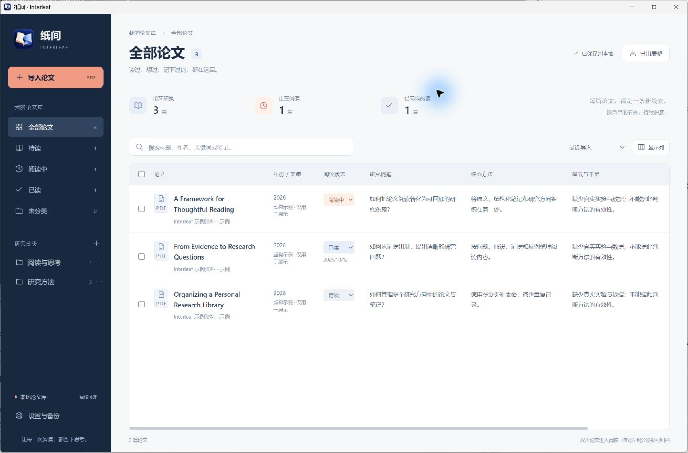
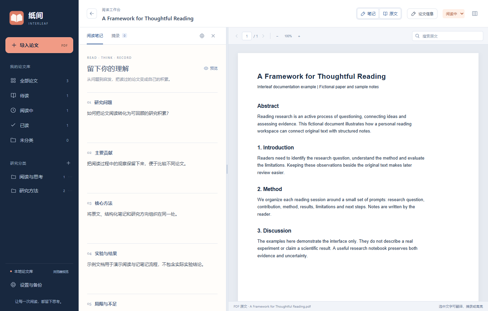

<p align="center"></p>
<h1 align="center">纸间 · Interleaf</h1>
<p align="center">在原文与理解之间，留下你的思考。</p>

纸间是一款本地论文阅读与笔记软件。左侧写下研究问题、方法、结果和局限，右侧直接阅读 PDF；回到论文库，用表格和分类回顾自己的积累。笔记由你填写，论文原件和阅读记录保存在本机。





截图使用虚构示例论文和笔记。

## 功能

- **边读边记**：PDF 与笔记并排，可独立隐藏、恢复两侧面板，并调整分栏宽度；自定义笔记栏目，支持 Markdown 编辑和预览，自动保存。
- **论文表格**：按标题、作者、标签及笔记搜索，筛选阅读状态、排序，选择需要展示的笔记列。
- **文件夹分类**：创建嵌套分类，同一篇论文可放入多个分类；支持批量归类。
- **PDF 阅读**：连续阅读、缩放、页码跳转、目录与文本搜索，记住阅读位置。
- **划词翻译**：选中文字后默认自动调用 Google 翻译，无需填写 API 密钥；浮窗可以拖动并固定位置。
- **摘录与高亮**：保存原文及译文，保留页码和位置，点击即可回到原文。
- **导出与备份**：导出 CSV 表格、Markdown 笔记；完整备份包含论文 PDF、笔记、分类与摘录。
- **本地存储**：SQLite 保存记录，导入 PDF 时复制原件并按内容去重，移动来源文件不影响阅读。

## 开始使用

从 [Releases](https://github.com/ly20030823/Interleaf/releases) 下载 Windows 版本：免安装版 `Interleaf.exe`，或安装包 `Interleaf_0.1.4_x64-setup.exe`。运行需要 Windows 的 WebView2 环境。

1. 点击「导入论文」，选择 PDF。
2. 补充标题、作者等信息；右侧读原文，左侧填写自己的理解。
3. 选中文字，翻译、保存摘录或高亮。
4. 建立分类，标记阅读状态，在表格中回顾并导出。

`Ctrl+S` 立即保存，`Alt+T` 翻译选区，`Esc` 关闭翻译浮窗。鼠标放在 PDF 阅读区时，`Ctrl+滚轮` 缩放原文（50%～250%），并与顶部缩放按钮同步；点击百分比恢复适合宽度。表格中双击论文即可进入阅读。

### 翻译

Google 翻译无需 API 密钥，但网络需要能够访问 Google。桌面版默认使用系统代理，也可在「设置与备份」填写代理地址或切换 Google 接入地址。选中的文字会发送给 Google，译文缓存在本地。

这里使用的是 Google 免密钥接口，不是付费 Cloud Translation API；它可能限流或变化，无法保证服务持续可用。翻译失败时可以重试或切换接入地址。

翻译浮窗初次出现时靠近选区。拖动标题栏后，后续选词在固定位置更新；保存摘录或高亮不会关闭浮窗。点击关闭或按 `Esc` 后，下次选词重新靠近选区出现。隐藏原文或离开论文也会重置浮窗，窗口缩小时会保持标题栏可见。

阅读工作台上方的「笔记」「原文」可切换两侧面板，隐藏后保留阅读位置、缩放和滚动状态；关闭最后一个面板时自动打开另一侧。升级到本版会默认启用自动翻译，之后可在设置中关闭，软件会记住你的选择。

### 资料和备份

资料目录可在「设置与备份」查看。移动免安装程序不会迁移资料；换电脑前请导出完整备份。完整备份使用 `.paperjournal` 扩展名，恢复会替换当前论文库，请先备份现有资料。

纸间沿用早期版本的资料标识及备份格式，升级名称和外观后可继续使用原有资料。高亮保存在论文库中，不改写 PDF；移除记录后 PDF 原件仍保留，但已移除的笔记需要从备份恢复。

## 开发

技术栈：**Tauri 2 · React · TypeScript · Vite · Rust · SQLite · PDF.js**。桌面端负责文件、数据库与翻译请求，React 负责论文库、笔记和 PDF 阅读界面。技术选型参考花笺·新枝，本项目独立实现。

Windows 开发环境需要 Node.js、pnpm、Rust、Microsoft C++ 构建工具与 WebView2。

```sh
pnpm install --frozen-lockfile
pnpm desktop
```

验证和构建：

```sh
pnpm test
pnpm build
cargo test --manifest-path src-tauri/Cargo.toml --locked
pnpm desktop:build
```

Windows 也可以使用 `run-dev.cmd` 和 `build-release.cmd`。安装包位于 `src-tauri/target/release/bundle/nsis/`。

桌面开发版默认使用项目内的 `.test-library/`，与正式版资料分开；可以用 `PAPER_JOURNAL_DATA_DIR` 指定其他开发资料目录。

`pnpm dev` 提供浏览器预览，使用独立的 IndexedDB 资料库。开发服务器只绑定本机；浏览器预览的翻译请求通过开发服务器转发，桌面版由 Rust 请求。

```text
src/                 论文库、笔记、PDF 阅读与资料模型
src-tauri/src/       文件导入、SQLite、翻译、备份恢复
public/              应用图标
docs/images/         界面截图
release/使用说明.md   简明使用说明
```

## 当前范围

标题初始来自 PDF 文件名，作者、年份、来源和笔记由用户填写。扫描 PDF 需要先做 OCR 才能划词；当前没有内置 OCR、AI 自动笔记、云同步或 Zotero 导入。现阶段提供 Windows 构建，其他系统尚未验证。

## 许可证

本项目使用 [MIT License](LICENSE)。第三方依赖遵循各自许可证。
